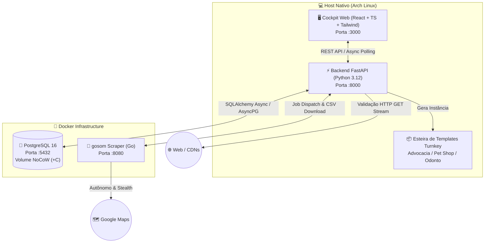

# 🛸 Abductor — Plataforma Autônoma de Inteligência de Prospecção & Sites Turnkey

<div align="center">


[](https://fastapi.tiangolo.com)
[](https://python.org)
[](https://react.dev)
[](https://www.typescriptlang.org)
[](https://tailwindcss.com)
[](https://www.postgresql.org)
[](https://www.docker.com)
[](#)

<p align="center">
  <b>Transforme dados públicos do Google Maps em fechamentos rápidos de Sites Vitrine com blindagem LGPD nativa.</b><br>
  Scraping autônomo, Lead Scoring com Hard Gate, CRM de bolso, gerador de pitches WhatsApp e esteira turnkey de sites institucionais perenes.
</p>

</div>

---

## 📑 Sumário

- [Visão Geral](#-visão-geral)
- [Arquitetura do Sistema](#-arquitetura-do-sistema)
- [Motores de Inteligência (Core Engine)](#-motores-de-inteligência-core-engine)
  - [Lead Scoring com Hard Gate](#1-lead-scoring-com-hard-gate)
  - [Validador Web Anti-Redirect](#2-validador-web-anti-redirect)
  - [Sanitizador Telefônico](#3-sanitizador-telefônico)
  - [Limpador e Humanizador de Nomes](#4-limpador-e-humanizador-de-nomes)
- [Cockpit Operacional (Frontend SPA)](#-cockpit-operacional-frontend-spa)
- [Esteira de Sites Turnkey & Verticais](#-esteira-de-sites-turnkey--verticais)
- [Estrutura do Repositório](#-estrutura-do-repositório)
- [Guia de Instalação e Execução](#-guia-de-instalação-e-execução)
  - [Pré-requisitos](#pré-requisitos)
  - [Configuração de Ambiente](#configuração-de-ambiente)
  - [Inicialização Rápida](#inicialização-rápida-launcher-unificado)
  - [Inicialização Manual](#inicialização-manual-passo-a-passo)
- [Testes e Qualidade](#-testes-e-qualidade)
- [Segurança & Privacidade](#-segurança--privacidade)
- [Documentação Exaustiva (`docs/`)](#-documentação-exaustiva-docs)

---

## 🎯 Visão Geral

O **Abductor** é uma plataforma local de alta performance projetada para prospecção e fechamento rápido de **Sites Vitrine One-Page perenes (Turnkey)** com **blindagem jurídica LGPD inclusa** (ticket de R$ 300 a R$ 850).

### O Problema de Mercado
Milhares de profissionais liberais e negócios locais (advogados, clínicas odontológicas, médicos, veterinárias, imobiliárias, arquitetos) possuem excelente reputação física e notas altas no Google Maps, mas sofrem de um dos seguintes problemas digitais:
1. **Sem presença na web:** Contam apenas com o perfil do Maps ou números soltos.
2. **Presença amadora/improvisada:** Usam links de agregadores (Linktree, Beacons, Bio) ou links crus de WhatsApp como "site".
3. **Sites quebrados:** Domínios expirados, erros 404, timeouts ou falhas de DNS.
4. **Passivo Jurídico LGPD:** Ausência de avisos de cookies e políticas de privacidade exigidas pela Lei Geral de Proteção de Dados (Lei nº 13.709/2018).

### A Solução Abductor
O Abductor resolve o funil de ponta a ponta:
- Extrai centenas de leads do Google Maps via scraper autônomo em Go.
- Valida o status do site e a existência de WhatsApp móvel com motores determinísticos assíncronos.
- Calcula um **Lead Score de 0 a 100** com **Hard Gate** (negócios com site profissional ativo são descartados automaticamente).
- Disponibiliza no Cockpit web abordagens comerciais prontas para disparo no WhatsApp em 1 clique.
- Gera automaticamente instâncias personalizadas (`site.config.json`) prontas para deploy imediato na Vercel em menos de 24 horas.

---

## 🏗 Arquitetura do Sistema

O Abductor adota uma **Arquitetura Híbrida de Alta Eficiência**:
- **Docker Containers:** Isolamento estrito de infraestrutura de persistência e extração pesada de dados.
- **Host Nativo (Arch Linux via `mise`):** Execução do backend FastAPI (Python 3.12) e frontend SPA (Vite + React 18) com latência zero e I/O direto.



---

## ⚙️ Motores de Inteligência (Core Engine)

Localizados em `backend/app/engines/`, os motores executam lógica pura e determinística:

### 1. Lead Scoring com Hard Gate (`scorer.py`)
- **Hard Gate Absoluto:** Se o lead possuir site convencional funcional (`website_status == 'ATIVO'`), o score é **imediatamente forçado a 0**. Não gastamos tempo prospectando quem já tem site estruturado.
- **Critérios de Pontuação:**
  - `IMPROVISADO` (Linktree, Beacons, Instagram, WhatsApp): **+30 pts**
  - `QUEBRADO` (404, DNS error, timeout): **+25 pts**
  - `SEM_SITE`: **+15 pts**
  - Celular Válido no Brasil (`MOBILE`): **+20 pts** (números inválidos ou 0800 sofrem penalidade de **-30 pts**)
  - Volume de Avaliações por Nicho: até **+25 pts**
  - Nota / Reputação (Rating 4.5+): até **+15 pts**
  - Ficha Reivindicada (`is_claimed`): **+10 pts**
- **Score Clamping:** Intervalo fixo `[0, 100]` com persistência do payload explicativo `score_breakdown` (JSONB) para exibição em tooltip no card do lead.

### 2. Validador Web Anti-Redirect (`validator.py`)
- Execução concorrente com `httpx.AsyncClient` e semáforo de 30 workers simultâneos.
- Usa requisição `GET` com `stream=True` (consome apenas os headers e aborta o body) e User-Agent desktop para evitar bloqueios de CDN/Cloudflare.
- **Blocklist Estrita de Agregadores:** detecta `linktr.ee`, `beacons.ai`, `instabio.cc`, `wa.me`, `instagram.com`, `canva.site`, `doctoralia.com.br`, etc., tanto na URL original quanto na URL final pós-redirecionamento.
- Códigos HTTP `401` e `403` são reconhecidos como sites protegidos por WAF e marcados como `ATIVO` (ativando o Hard Gate).

### 3. Sanitizador Telefônico (`sanitizer.py`)
- Validação oficial via biblioteca `phonenumbers` com parsing regional brasileiro (`BR`).
- Identifica com precisão se a linha é móvel (`MOBILE`), fixa (`LANDLINE`) ou inválida.
- Normaliza o número nacional puro (DDD + 9 dígitos) para geração do link direto `https://wa.me/55${phone}`.

### 4. Limpador e Humanizador de Nomes (`cleaner.py`)
- `leads.name` armazena o nome original completo do Google Maps no banco de dados para integridade de busca e dorks.
- A limpeza de sufixos jurídicos (`LTDA`, `ME`, `EPP`, `S/S`, etc.) ocorre **exclusivamente em runtime** durante a interpolação dos roteiros de pitch e exportação de templates.

---

## 🖥 Cockpit Operacional (Frontend SPA)

Interface moderna, escura, responsiva e otimizada para operação rápida sem sobrecarga cognitiva:

| Módulo | Descrição |
| :--- | :--- |
| **Buscador & Jobs** | Disparo de extração do Google Maps por nicho e cidade, monitoramento em tempo real da barra de progresso com Watchdog passivo. |
| **Pipeline CRM** | Kanban visual com colunas de status (`PROSPECTADO`, `CONTATADO`, `NEGOCIANDO`, `FECHADO`, `DESCARTADO`), notas rápidas e filtro por Score. |
| **Lead Cards & Drawer** | Exibição detalhada com tooltip de breakdown do score, endereço, telefone sanitizado, link do Maps e botão de WhatsApp direto. |
| **Gerador de Pitches** | Scripts de abordagem pré-formatados com quebra de objeções, tom consultivo, argumentos de autoridade e blindagem LGPD. |
| **Exportador Turnkey** | Modal de exportação de dados com geração direta do `site.config.json` para preencher o template em segundos. |
| **Gestor de Nichos** | Painel de configuração de regras e pontuações por segmento profissional. |

---

## 📦 Esteira de Sites Turnkey & Verticais

Localizada em `templates/`, a esteira fornece modelos de Sites Vitrine One-Page hiper-otimizados (PageSpeed 95+, sem dependências pesadas, HTML/CSS/JS puros e sem frameworks JS pesados no cliente final):

- **`vercel-advocacia/`**: Especializado para advogados e escritórios jurídicos. Monograma vetorial, áreas de atuação, conformidade OAB e página LGPD dedicada (`privacidade.html`).
- **`vercel-petshop/`**: Especializado para clínicas veterinárias, banho e tosa e daycare animal. Galeria de especialidades, plantão 24h e integração de WhatsApp.
- **`site.config.json`**: Arquivo de parametrização única. Basta colar a configuração exportada pelo Abductor para personalizar dados do negócio, serviços, fotos, telefones, horários e termos de privacidade.
- **Deploy em 1 Comando:** `npx vercel --prod` dentro da pasta do cliente.

---

## 📁 Estrutura do Repositório

```text
/Abductor/
├── AGENTS.md                  # Protocolo de engenharia e diretrizes de IA
├── docker-compose.yml         # Orquestração do PostgreSQL 16 e gosom scraper
├── .env.example               # Template de variáveis de ambiente seguras
├── abductor.sh                # Launcher unificado do cockpit
├── backend/                   # API FastAPI (Python 3.12)
│   ├── app/
│   │   ├── core/              # Configurações, banco assíncrono e normalizadores
│   │   ├── engines/           # Motores puros: scorer, validator, sanitizer, cleaner
│   │   ├── models/            # Modelos ORM (Search, Lead)
│   │   ├── schemas/           # DTOs Pydantic v2
│   │   ├── routers/           # Endpoints REST (searches, leads, scripts, niches)
│   │   ├── services/          # Pipeline de ingestão, cliente gosom e runner assíncrono
│   │   └── verticals/         # Regras JSON por nicho (advocacia, petshop, etc.)
│   ├── init.sql               # DDL do PostgreSQL com extensões e índices
│   ├── pyproject.toml         # Dependências do backend
│   └── tests/                 # Suíte completa de testes unitários e de integração
├── frontend/                  # SPA React 18 + TypeScript + Tailwind
│   ├── src/
│   │   ├── components/        # LeadCard, PitchModal, SearchForm, Modais de Exportação
│   │   ├── pages/             # Dashboard, Pipeline, Pitches, Playbook, Notes
│   │   └── services/          # Cliente Axios tipado
│   └── package.json           # Dependências do frontend
├── templates/                 # Esteira Turnkey de Sites Vitrine
│   ├── vercel-advocacia/      # Template para escritórios de advocacia
│   └── vercel-petshop/        # Template para clínicas veterinárias e pet shops
└── docs/                      # Documentação completa de engenharia (00 a 09)
```

---

## 🚀 Guia de Instalação e Execução

### Pré-requisitos
- **Linux** (Arch Linux, Ubuntu ou similar)
- **Docker** e **Docker Compose**
- **Python 3.12** e **Node.js 20+** (recomendado via gerenciador `mise`)

### Configuração de Ambiente

1. Clone o repositório:
```bash
git clone https://github.com/gabrielolvr/Abductor.git
cd Abductor
```

2. Crie o arquivo de variáveis de ambiente a partir do template:
```bash
cp .env.example .env
cp .env.example backend/.env
```

3. Se estiver usando Btrfs (ex: Arch Linux), garanta a diretiva NoCoW para evitar fragmentação no banco:
```bash
mkdir -p data/postgres data/gosom
chattr +C data/postgres data/gosom 2>/dev/null || true
```

### Inicialização Rápida (Launcher Unificado)

O repositório inclui um script inteligente `abductor.sh` que sobe o Docker, inicia os servidores de backend e frontend e abre o cockpit automaticamente:

```bash
chmod +x abductor.sh
./abductor.sh
```

### Inicialização Manual (Passo a Passo)

#### 1. Subir Infraestrutura Docker
```bash
docker compose up -d
```
Verifique a saúde dos serviços:
- **PostgreSQL 16:** `localhost:5432`
- **gosom Scraper:** `localhost:8080`

#### 2. Configurar e Iniciar o Backend
```bash
cd backend
python -m venv .venv
source .venv/bin/activate
pip install -e .
uvicorn app.main:app --reload --host 0.0.0.0 --port 8000
```
Swagger interativo disponível em: `http://localhost:8000/docs`

#### 3. Configurar e Iniciar o Frontend
```bash
cd ../frontend
npm install
npm run dev
```
Cockpit disponível em: `http://localhost:3000`

---

## 🧪 Testes e Qualidade

O projeto conta com suíte de testes unitários isolados para todos os motores de regras e endpoints da API:

```bash
# Rodar testes do backend
cd backend
pytest -v tests/

# Checagem de tipagem estática no backend
python -m mypy app/

# Checagem de tipagem estática no frontend
cd ../frontend
npx tsc --noEmit
```

---

## 🔒 Segurança & Privacidade

- **Proteção de Segredos:** Arquivos `.env`, bancos de dados locais (`data/`), ambientes virtuais (`.venv`) e pastas de instâncias de clientes (`templates/*/clientes/*`) estão estritamente contidos no `.gitignore`.
- **Blindagem LGPD:** O Abductor opera exclusivamente sobre dados cadastrais tornados manifestamente públicos pelos próprios estabelecimentos no Google Maps (Art. 7º, § 4º da Lei nº 13.709/2018).
- **Hard Gate Ético:** Estabelecimentos que já contam com sites estruturados são imediatamente descartados pelo algoritmo de scoring, prevenindo prospecções invasivas ou desnecessárias.

---

## 📚 Documentação Exaustiva (`docs/`)

Para detalhes arquiteturais aprofundados, consulte os documentos na pasta `docs/`:

- **[00 - Central de Controle (MOC)](docs/00%20-%20MOC%20-%20Central%20de%20Controle.md):** Mapa de navegação e conceitos gerais.
- **[01 - Visão de Produto (PRD)](docs/01%20-%20PRD%20-%20Visao%20de%20Produto.md):** Personas, modelo de negócio e esteira de monetização.
- **[02 - Requisitos do Sistema (SRS)](docs/02%20-%20SRS%20-%20Requisitos%20do%20Sistema.md):** Requisitos funcionais, regras do Scorer e Sanitizer.
- **[03 - Arquitetura e Engenharia (SDD)](docs/03%20-%20SDD%20-%20Arquitetura%20e%20Engenharia.md):** Diagramas de sequência, watchdog e ingestão assíncrona.
- **[04 - Modelagem de Dados (DATA)](docs/04%20-%20DATA%20-%20Modelagem%20e%20Banco.md):** Esquema DDL do PostgreSQL 16, índices e integridade N:N.
- **[05 - Decisões de Arquitetura (ADRs)](docs/05%20-%20ADR%20-%20Decisoes%20de%20Arquitetura.md):** Histórico das 11 decisões de engenharia do sistema.
- **[06 - Playbook Comercial](docs/06%20-%20PLAYBOOK%20-%20Abordagens%20e%20Vendas.md):** Scripts de abordagem via WhatsApp, quebra de objeções e pitch de blindagem LGPD.
- **[07 - Verticais e Boilerplates](docs/07%20-%20TEMPLATES%20-%20Verticais%20e%20Boilerplates.md):** Especificação da esteira de templates turnkey.
- **[08 - Runbook do Host Arch Linux](docs/08%20-%20RUNBOOK%20-%20Setup%20da%20Maquina.md):** Configuração de hardware, Btrfs NoCoW e mise.
- **[09 - Checklist de Execução](docs/09%20-%20TASKS%20-%20Checklist%20de%20Execucao.md):** Backlog prático de implementação e validação.

---

<div align="center">
  <sub>Construído por <b>Gabriel Oliveira</b> para prospecção autônoma e geração contínua de valor digital.</sub>
</div>
